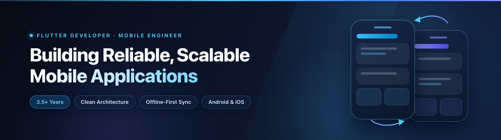

  

  
  
  

---

### 👨🏻‍💻 About Me

Hi, I'm **Borhen** 👋 — a Flutter developer and mobile software engineer based in Tunisia with **3.5+ years of experience** building, shipping, and maintaining production **Android and iOS** applications. I work primarily with **Flutter/Dart**, **BLoC/Cubit**, **Clean Architecture**, and **Firebase**, handling the full lifecycle from architecture to store delivery.

- 🔄 **Offline-First & Real-Time Sync:** Designing resilient local-first mobile architectures using SQLite/Floor, Cloud Firestore, persistent outbox queues, and conflict resolution.
- 🏗️ **Architecture & Modernization:** Clean Architecture, SOLID principles, modular refactoring, and legacy Flutter migrations.
- 🚀 **End-to-End Mobile Delivery:** Certificates, code signing, CI/CD pipelines, and production releases on the App Store & Google Play.
- 🧩 **Full-Stack & Native Capabilities:** REST/GraphQL backends with Node.js, Express, and MongoDB, plus native Android (Kotlin) and iOS (Swift) experience.
- 🎓 **Education:** Engineering Degree in Computer Science, ESPRIT (2020 – 2025).
- 🌍 **Languages:** French · English · Arabic

---

### 🛠️ Tech Stack

**Mobile & Frontend**

**Backend, Cloud & Data**

**DevOps & Tooling**

- **State Management:** BLoC / Cubit, Provider, GetX
- **Data & DI:** Floor (SQLite), Cloud Firestore, Outbox Pattern, GetIt, Repository Pattern
- **Quality & Monitoring:** Unit & Widget Testing, Firebase Crashlytics & Analytics
- **CI/CD:** GitHub Actions, Fastlane, Codemagic

---

### 📂 Selected Open-Source Projects

| Project | Description | Stack |
| :--- | :--- | :--- |
| [**escapeVRoom**](https://github.com/paradax005/escapeVRoom) | Mobile app for the virtual escape room gaming community | Flutter, Firebase |
| [**job_finder**](https://github.com/paradax005/job_finder) & [**backend**](https://github.com/paradax005/job_finder_backend) | Full-stack platform connecting job seekers and employers | Flutter, Node.js, Express |
| [**Larix**](https://github.com/paradax005/Larix) | Mobile frontend for human resource management workflows | Flutter, Dart |
| [**Party_Planner**](https://github.com/paradax005/Party_Planner) & [**iOS**](https://github.com/paradax005/PartyPlanner-ios) | Native Android & iOS event planning apps with real-time notifications | Kotlin, Swift, Node.js |
| [**Train-App-DevOps**](https://github.com/paradax005/Train-App-DevOps) | End-to-end CI/CD pipeline for a train ticket booking application | Java, DevOps |
| [**flutter_workshop**](https://github.com/paradax005/flutter_workshop) | Hands-on guide covering core Flutter widgets and layouts | Flutter, Dart |

---

### ⚙️ GitHub Analytics

  
  

> **Note:** Stats only reflect public repositories and GitHub contribution counts; most recent production work lives in private repositories.

---

### 📫 Connect With Me

  Feel free to reach out for collaborations or questions.

  
  
  

(<a href="#top">back to top</a>)

<h6 align="center">👇🏻 Explore my pinned open-source repositories below 👇🏻</h6>
